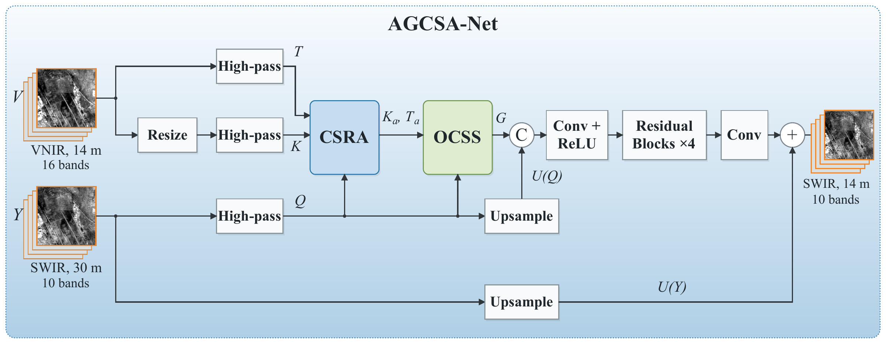
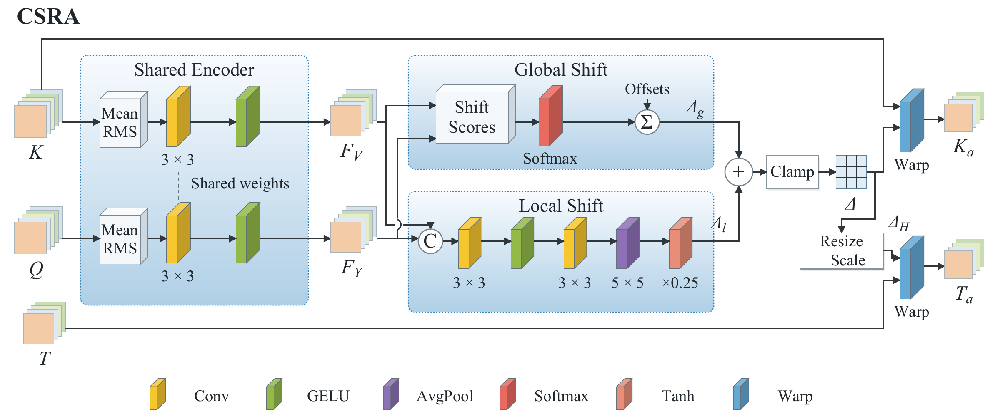
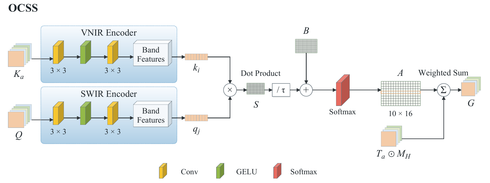

# AGCSA-Net: Alignment-Guided Cross-Spectral Attention for VNIR–SWIR Image Fusion

Han Qin, Haixu He, Jinhao Zhang, Peng Liu, and Jining Yan

## Overview

AGCSA-Net fuses visible and near-infrared (VNIR) imagery with shortwave infrared (SWIR) imagery to enhance SWIR spatial detail while preserving spectral information. For Geology-1, it uses 16-band VNIR imagery at 14 m and 10-band SWIR imagery at 30 m to reconstruct 10-band SWIR imagery on the 14 m VNIR grid.

The network jointly learns spatial alignment and adaptive multiband guidance. Training combines reduced-resolution reference supervision with a native-scale SWIR observation constraint: reference images guide detail recovery, while the original SWIR observations constrain spectral changes at native resolution.

*Overall architecture of AGCSA-Net. Band images are schematic.*

## Cross-Spectral Residual Alignment (CSRA)

CSRA estimates residual spatial offsets between VNIR and SWIR structures. It applies the same correction to the structures used for band comparison and the high-resolution VNIR details used for fusion, linking guidance selection and detail transfer to the same surface locations.

## Observable-Conditioned Cross-Spectral Selection (OCSS)

OCSS combines learned band relationships with structural similarities computed after alignment to weight VNIR details for each SWIR band. The weights adapt to the input patch and are shared across spatial locations within that patch. The resulting guidance images support the reconstruction of spatial details in the SWIR output.

## Code and Data Availability

The source code and data for AGCSA-Net will be made publicly available upon publication.

## Contact

Jining Yan: [yanjn@cug.edu.cn](mailto:yanjn@cug.edu.cn)
